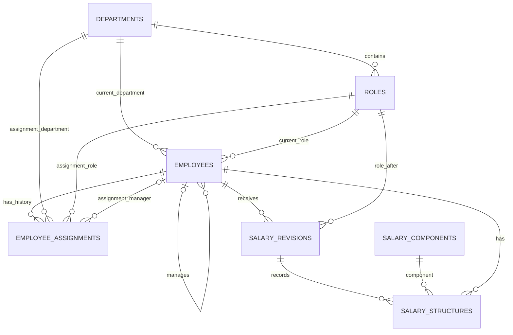

# LedgerForge entity relationships

Employee `manager_id` points to another employee because a manager is also a person in the employee directory. It is nullable for top-level employees. Assignment rows preserve each employee's department, role, manager, and effective dates over time; the current employee fields are a convenient snapshot.

Legitimate nullable examples: `employees.exit_date` remains empty while the person is employed; `employees.manager_id` is empty for a top-level executive; `employee_assignments.effective_to` is empty on an assignment that is still active. `date_of_birth` can also be empty when not collected.

Salary revision `previous_annual_fixed`, `pct_change`, and `approved_by` are nullable because joining records have no previous salary or percentage change, and the supplied joining revisions have no approver recorded.
