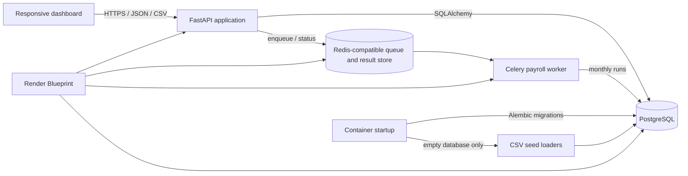

# LedgerForge Phase 4 architecture

The payroll worker commits one monthly run at a time. Job state and progress are
stored by Celery's result backend. CSV exports are generated from the database
by authenticated API routes. The live Render services, credentials, and hosting
evidence still need to be supplied by the deployment operator.
